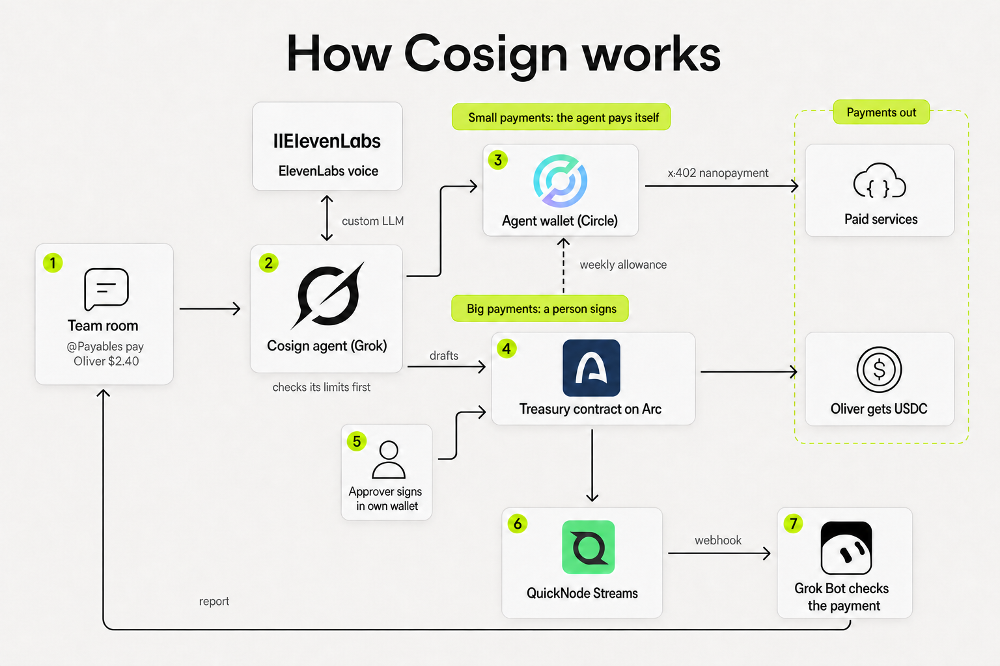
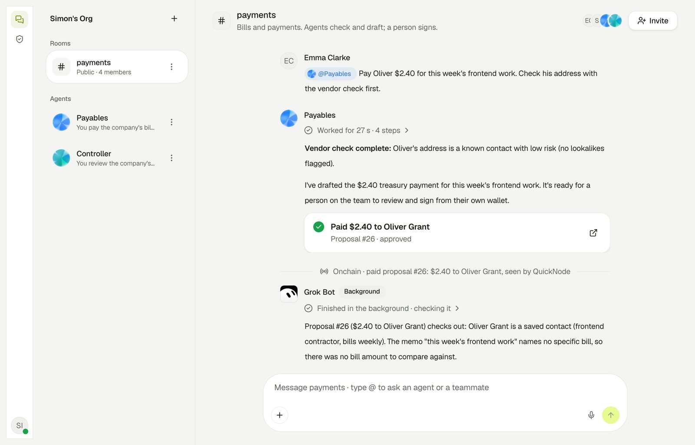
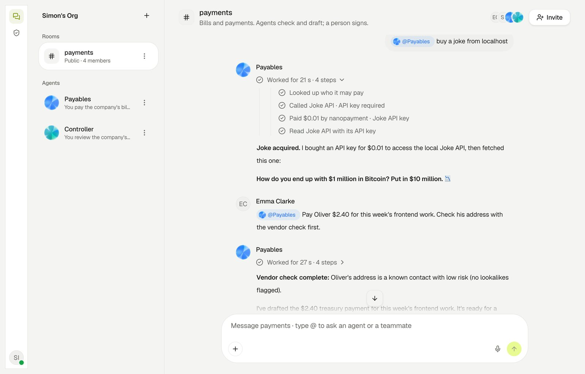
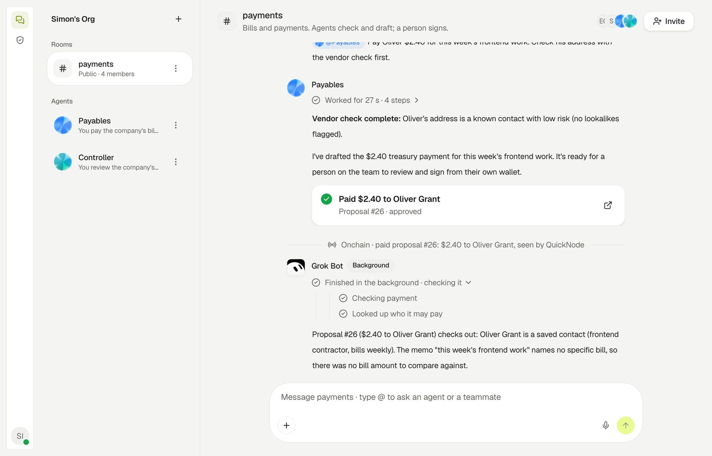
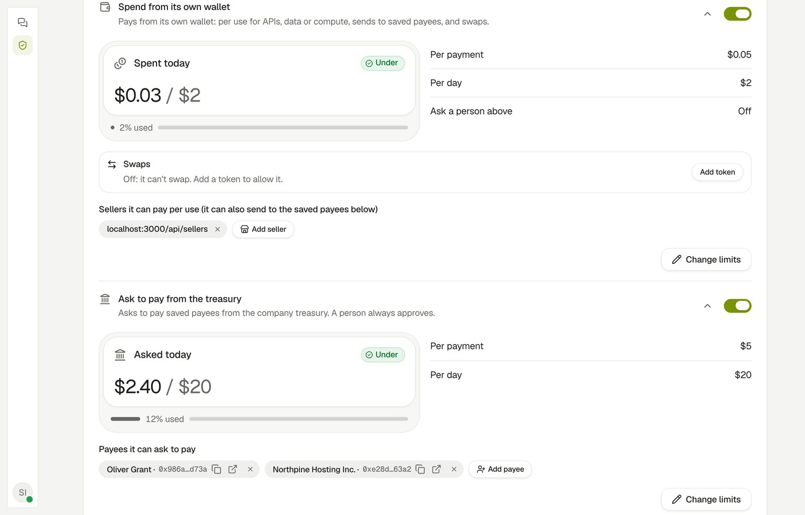
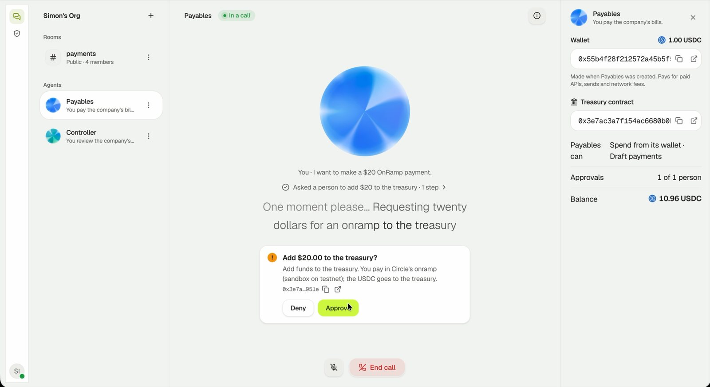
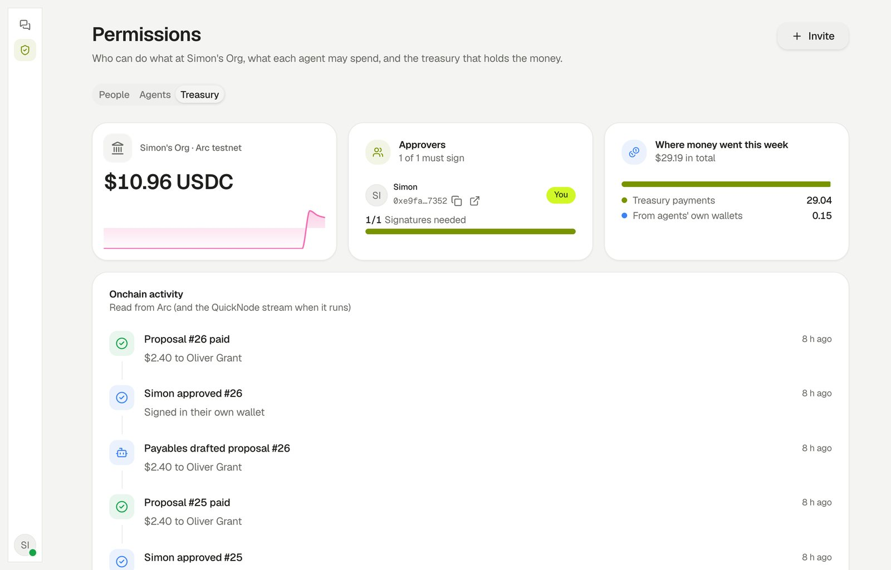

# Cosign

**Shared AI agents that check and draft your team's stablecoin payments. A person still signs.**



Small teams that pay contractors in stablecoins wait on one or two people to check and sign every payment, and a
mistake can't be undone. Cosign gives the whole team shared AI agents. Each agent has its own wallet and limits, and
refills that wallet from the team's treasury contract on Arc, up to a weekly allowance an approver sets onchain. It pays
for small things itself (a one-cent API call); for bigger bills it checks, drafts, and waits for a person to sign from
the treasury.

Built for the UBC 2026 Hackathon.

| | |
|---|---|
| Track | Agentic Payments and AI |
| Chain award | Best use of Arc |
| Bounties | QuickNode Streams, Grok Bot, ElevenLabs |
| Demo video | [youtu.be/4_txyu3nwbE](https://youtu.be/4_txyu3nwbE) (2:59) |
| Devpost | _link_ |
| Grok Bot | [Cosign Agent](https://x.ai/bot/40hHKyBjRaOmvwp6CICdo), shared from the Grok Bot app · [chat export](docs/grok-bot-chat-export.md) |

## The problem

- A team pays a contractor in USDC. A wrong address or a wrong amount is gone for good.
- So the one or two people who can sign check every bill by hand, then sign. Everyone else asks and waits.
- AI is good at that checking, but today it lives on one person's machine, and the team can't use it.

## How Cosign works



_Emma asks Payables to pay Oliver $2.40. Payables runs a $0.02 vendor check and drafts the payment on the team's
treasury contract. Simon approves it from his own wallet, QuickNode Streams sees it land on Arc, and Grok Bot checks
it._

- **Shared agents.** Anyone on the team asks an agent in a shared room
  (`@Payables pay Oliver $2.40 for this week's frontend work`).
- **Each agent has its own wallet and limits.** It pays for services per use (x402, Circle Gateway nanopayments),
  within limits a person sets: allowed sellers, cents per call, dollars per day.
- **Agents refill from the team's treasury.** When its wallet runs low, the agent draws from the treasury contract,
  up to a weekly allowance an approver set onchain. Each refill is its own transaction, and the contract refuses
  anything over the allowance, even if our server asked.
- **Big payments wait for a person.** The agent drafts them on the team's treasury contract on Arc. An agent can draft
  but never approve: only an approver's own wallet can make the treasury pay a payee.
- **Every payment is checked again.** QuickNode Streams sees each treasury payment on Arc and wakes Grok Bot, which
  checks it against the bill and saved payees, and reports in the room. In our test runs it caught ten repeated $2.40
  payments to the same contractor and asked an approver to confirm.
- **People and roles.** Roles decide who can approve and who can ask agents to pay. Approving always happens in the
  approver's own wallet.
- **Voice.** Talk to an agent through ElevenLabs. The same agent answers, with the same tools and limits.

| | |
|---|---|
|  |  |
| **Pays per use.** The Joke API answers 401, the agent pays $0.01 by nanopayment for a 15-minute key, then reads it. | **Checked again.** QuickNode Streams sees the payment on Arc; Grok Bot checks it and reports in the room. |
|  |  |
| **Limits per agent.** Per payment, per day, allowed sellers, saved payees. Paying a payee from the treasury always needs a person. | **Voice.** ElevenLabs does the voice; Cosign's agent does the thinking. Here it asks a person to add $20. |

## The agent's decision loop

Every turn runs the same loop (`src/lib/agent/loop.ts`), whether it comes from a chat, a room, a voice call or a Grok
Bot job:

1. **Read.** The agent gets the message, its instructions, the room's guidelines, its memory index and a pinned ledger
   of money facts.
2. **Plan.** Grok picks tools: look up who it may pay, pay for a service, draft a treasury payment, refill its wallet
   from the treasury, ask for funds, search the web or X.
3. **Check.** Every money tool goes through `src/lib/agent/controls.ts` first: the asker's rights, allowed sellers and
   saved payees, per-payment and per-day limits, payments per hour, freeze and end date. A refused call goes back to
   Grok with the reason and never reaches Circle.
4. **Act.** Circle signs with the agent's own wallet: an x402 nanopayment, `propose` on the treasury contract, or
   `topUpAgent` to refill within its weekly allowance. The agent's wallet has no approver role, so it can't make the
   treasury pay anyone else.
5. **Report.** The agent answers with what its tools actually did. Each step shows in the room, and the spend log
   updates its limits.
6. **Check again.** When a treasury payment lands on Arc, QuickNode Streams starts a Grok Bot job that checks it
   independently and asks a person when something doesn't match.

## Safety

- Agents can draft but never approve; approvers are people's wallets.
- Before Circle signs anything, the server checks the agent's limits: per payment, per day, per week, per month,
  payments per hour, allowed sellers, saved payees, "ask a person above $X", freeze, end date.
- The treasury contract enforces approvals and each agent's weekly allowance, even if the server were wrong.
- A teammate without "can ask agents to pay" can chat with an agent, but its spending switches off for them.
- Grok Bot checks every treasury payment after it lands and asks a person when something doesn't match.

## What we used

Grouped by sponsor. The bold line says what each piece does in Cosign; the lines under it say how it's wired in and
where the code lives.

### Arc

**Arc testnet** (chain id 5042002): the chain every payment settles on.

- Agents and people pay gas in USDC, Arc's native gas token. Drafting a payment costs the agent about $0.004.
- We read Arc with viem (`src/lib/arc.ts`): proposals, balances, receipts. If the QuickNode stream was stopped,
  `src/lib/activity/backfill.ts` reads the gap from Arc's public RPC in paced 10,000-block chunks, so the treasury
  feed has no holes.
- USDC is used through its ERC-20 interface at `0x3600…0000` (6 decimals). Arc's native balance is the same USDC with
  18 decimals; the event decoder handles both.

**`CompanyTreasury` and `TreasuryFactory`** (Solidity 0.8.30, OpenZeppelin, built and tested with Foundry): one
treasury contract per team. People approve; the contract pays.

- `TreasuryFactory.createTreasury` deploys a team's treasury and emits `TreasuryCreated`, which our stream watches.
  The person creating the team sends that transaction from their own wallet; the API only prepares it
  (`POST /api/v1/workspaces/prepare`).
- `propose(to, amount, memo)` is sent by an agent's wallet, which holds the proposer role. `approve(id)` is sent by an
  approver's wallet; at the threshold the contract pays the payee directly in that same transaction. Also `cancel`.
- Approvers and the threshold change only through `proposeApproverChange` plus approvals.
- Weekly allowance: an approver sets `setAgentAllowance(agent, perPeriod, period)`; the agent calls `topUpAgent(amount)`
  to refill its own wallet, up to a ceiling the contract enforces.
- `pause` (approvers or a guardian) stops proposals and top-ups; only an approver can `unpause`.
- Tests: `contracts/test/CompanyTreasury.t.sol` (28 Foundry tests). ABIs are generated into
  `src/lib/contracts/abis.ts`. Every USDC transfer out uses OpenZeppelin's `SafeERC20`, and `approve` and
  `topUpAgent` sit behind its `ReentrancyGuard`.
- Why our own contract: for the hackathon we kept the whole flow in one small contract that we could test end to end
  and that emits the events our stream and Grok Bot react to. In production the same design maps onto a Safe: the
  Safe's owners and threshold are the approvers, agents propose as Safe delegates, the weekly allowance is Safe's
  Allowance Module, and pause is a Safe guard.

### Circle

**Circle developer-controlled wallets** (`@circle-fin/developer-controlled-wallets`): each agent's own wallet.

- Creating an agent calls `createWallets` for one EOA on `ARC-TESTNET`. Our server holds Circle's API key and entity
  secret, never a private key.
- The agent's onchain calls (`propose`, `topUpAgent`, the Gateway deposit) go through
  `createContractExecutionTransaction`, plain sends through `createTransaction`, and x402 payment authorizations
  through `signTypedData` (EIP-712).
- Before any of these, `src/lib/agent/controls.ts` checks the agent's limits. A refused call never reaches Circle.

**Circle Gateway nanopayments** (`@circle-fin/x402-batching`): how an agent pays a cent, or a hundredth of a cent,
with no gas per payment.

- Once: the agent's wallet approves and deposits USDC into Circle's Gateway wallet contract (`0x0077777d…19B9`),
  in `src/lib/x402/gateway.ts`.
- Each payment: `BatchEvmScheme` builds an EIP-3009 authorization against the Gateway wallet, Circle signs it with
  the agent's wallet, and Gateway settles many of them later in one batch.
- Seller side: our demo APIs verify and settle with `BatchFacilitatorClient` (`src/lib/x402/seller.ts`), the same
  pieces as Circle's `createGatewayMiddleware`, adapted to Next.js route handlers.

**x402** (`@x402/core`, `@x402/evm`, `@x402/fetch`, protocol v2): the HTTP 402 handshake agents use to buy things.

- Buyer: the agent's `paid_fetch` tool (`src/lib/x402/buyer.ts`) calls a URL. On a 402 it reads `PAYMENT-REQUIRED`,
  picks a rail (Gateway when offered and funded, otherwise plain `exact`), checks the real price against the agent's
  limits, has Circle sign, and retries with `PAYMENT-SIGNATURE`. The `PAYMENT-RESPONSE` receipt goes into the
  agent's spend log, which its limits read.
- Seller: `requirePayment` (`src/lib/x402/seller.ts`) answers 402 offering both rails. Plain `exact` payments
  (EIP-3009 on USDC) are settled by Circle's facilitator.
- API keys sold over x402 (`src/lib/x402/key-shop.ts`): an API answers 401 with where to buy a key, the key shop
  answers 402, and paying returns a 15-minute key that the agent sends as `X-API-Key`. Paying is the sign-up.

**Circle x402 Discovery** (Agent Marketplace Discovery API): how agents find paid services they don't know yet.

- The `discover_services` tool searches Circle's public directory (`src/lib/x402/discovery.ts`, no key needed). We
  take only URLs, prices and rails from a listing; its text is untrusted data and gets cut short.
- Finding a service doesn't let the agent pay it. The seller must be on the agent's allowed list.

**Circle App Kit** (`@circle-fin/app-kit` with `@circle-fin/adapter-circle-wallets`): more money tools for an agent's
own wallet.

- `send`, `swap` (USDC → EURC), `bridge` (USDC to another chain over CCTP), `gateway_deposit`, `earn` (a Morpho vault
  on Arc testnet) and `borrow` (quotes only: App Kit borrows only from smart-contract wallets, and agent wallets are
  EOAs). All in `src/lib/appkit.ts`.
- Each one signs through the Circle Wallets adapter, so the agent's own wallet signs, and each checks the agent's
  rules first (swaps stay off until a person adds a token). Tested live; not in the video.

**Circle onramp** (App Kit server): how money comes into the treasury.

- When the treasury is too short, an agent calls `request_funds`. Cosign saves a funding request and @mentions an
  approver in the team feed (`src/lib/server/funding.ts`).
- The approver clicks Add funds: `POST /api/v1/workspaces/:ws/onramp` opens a sandbox onramp session whose
  destination is always the team treasury. The agent never sees the widget or any card details.

### QuickNode

**QuickNode Streams**: sees every Cosign payment on Arc and pushes it to our server about a second after the block.

- One stream on Arc testnet, dataset `logs`. Its JavaScript filter (`src/lib/quicknode/filter.ts`) runs on QuickNode
  for every block and keeps only `TreasuryCreated` from our factory, our treasury events (`ProposalCreated`,
  `ProposalApproved`, `PaymentExecuted`, `AgentToppedUp`…) and USDC transfers that touch our wallets. A block with
  nothing for us sends nothing.
- The addresses that count as ours live in QuickNode Key-Value Store lists. The server updates them whenever a team
  or agent is created (`src/lib/quicknode/kv.ts`), so the filter never needs redeploying.
- Destination: a webhook to `POST /api/webhooks/quicknode`. We verify its HMAC-SHA256 signature
  (`x-qn-signature`, `src/lib/quicknode/verify.ts`), decode the logs into readable rows, and store each one once
  (deduped on tx hash + log index).
- What it drives: the treasury page's live feed, pushed to open pages over server-sent events; and Grok Bot: a fresh
  `PaymentExecuted`, or money coming in, starts a Grok Bot job to check it (`src/lib/server/watch.ts`).
- Full settings, filter logic and measurements: [QuickNode Streams: details](#quicknode-streams-details).

**QuickNode x402 RPC** (`x402.quicknode.com/arc-testnet/`): a real paid API from outside, for agents.

- In the agent's list of known sellers: JSON-RPC calls (such as `eth_getBalance`) through `paid_fetch`, $0.0001 a
  call, paid over x402.
- Off by default. A person adds `x402.quicknode.com` to the agent's allowed sellers first.

### xAI

**Grok** (xAI Responses API, `grok-4.20-0309-reasoning`): the LLM behind every Cosign agent, in chat, rooms and voice.

- `src/lib/agent/loop.ts` calls `https://api.x.ai/v1/responses` with the agent's instructions and tools. Each agent
  keeps one conversation, chained with `previous_response_id`.
- Long histories: at 150K tokens Grok summarizes the work, and a new chain starts from that summary, a pinned ledger
  of money facts (never summarized away) and the agent's memory index.
- Prompt caching: the instructions and tool list are a fixed prefix per agent, routed to the same cache with
  `prompt_cache_key` and the `x-grok-conv-id` header.
- Grok's built-in `web_search` and `x_search` run on xAI's side. Our tools (pay, draft, memory, commands in the
  microVM) run on our server, and every money tool is checked against the agent's limits before Circle signs.

**Grok Bot**: the always-on checker.

Grok Bot is Cosign's always-on checker. When QuickNode Streams sees a treasury payment land on Arc, Cosign sends a job
to our Grok Bot routine by webhook. Grok Bot calls Cosign's tools with a token that works only for that job, checks the
payment against the bill and saved payees, and posts what it found in the team's room. If something doesn't match, it
@mentions an approver instead of acting.

- The bot we built, shared from the Grok Bot app: [Cosign Agent](https://x.ai/bot/40hHKyBjRaOmvwp6CICdo). Anyone
  can add it to their own Grok Bot and connect it to a Cosign workspace.
- Chat export: [docs/grok-bot-chat-export.md](docs/grok-bot-chat-export.md), our whole Grok Bot chat from setup to the
  published bot (Nov 12–17), with our tunnel URL and a token blacked out.
- What it caught in our test runs: ten identical $2.40 payments to Oliver (proposals #17 to #26, $24 in total), flagged
  as possible duplicates for an approver to confirm, including once when Payables had reported nothing wrong; and
  Northpine Hosting bills paid $0.08 of $0.80, flagged as $0.72 short.
- Connect: a teammate pastes our setup message into Grok Bot. It creates a webhook routine and shows the routine's
  webhook URL and key; the teammate pastes both into Cosign, which sends a ping and waits for the ack.
- Each job: Cosign POSTs one JSON body to the routine's webhook with the job, a token for that job only, our tool API
  and callback URLs. Grok Bot calls `GET /api/v1/bot/context` and `POST /api/v1/bot/tools/{name}` with the token as a
  Bearer header, and reports to `/api/v1/bot/tasks/:id/ack`, `/progress` and `/result`. The token dies with the job.
- Every tool call gets the same checks as our own loop, under the rights of the person the job is for. Grok Bot has
  20 tools (balances, proposals, paid calls over x402, memory, @mentions and more), none that run code on our machine.
- The same tools are also an MCP server at `POST /api/v1/mcp` (JSON-RPC over Streamable HTTP, with a 30-day connector
  token), for Grok Bot's "Add a custom MCP".
- Jobs come from QuickNode (a payment landed: check it), from schedules (`POST /api/v1/cron/tick`) and from other
  agents' @mentions. With no Grok Bot connected, the job runs on our own loop instead.

### ElevenLabs

**ElevenLabs Agents with a Custom LLM**: talk to a Cosign agent. ElevenLabs does the voice; Cosign does the thinking.

- `pnpm voice setup` creates one ElevenLabs agent per Cosign agent through the ElevenLabs API
  (`/v1/convai/agents/create`). Its Custom LLM URL points at `POST /api/v1/voice/llm/chat/completions`, and ElevenLabs'
  own models are off, so nothing answers without our rules.
- Starting a call: `POST /api/v1/agents/:id/voice` returns a signed URL (from `get-signed-url`), a 30-minute session
  token and the call's dynamic variables. The token rides in a secret variable that ElevenLabs sends back as
  `X-Cosign-Auth`; it never reaches a model.
- Each spoken turn arrives as an OpenAI-style Chat Completions request. We run the normal Cosign loop (same agent,
  tools, limits and chat thread) and stream the answer back. Before a tool runs, the agent says one sentence about
  what it's doing (`say_first`), so the call isn't silent while it works.
- Turn-taking is eager, with speculative turns off. When the call ends, ElevenLabs' post-call webhook (HMAC-signed,
  `elevenlabs-signature`) hits `POST /api/v1/voice/webhook`, which closes the session and keeps the summary.

**`@elevenlabs/react`**: the call in the browser.

- `useConversation().startSession({ signedUrl, dynamicVariables, connectionType: "websocket" })` in
  `src/app/(app)/chat/voice.ts`. The orb is from ElevenLabs UI.

### The app

**Next.js 16 (App Router) and React 19**: one app serves the pages, the API and the demo sellers.

- Pages are in `src/app/(app)/`: sign-in, chat and rooms, permissions, treasury.
- One catch-all route, `src/app/api/v1/[...path]/route.ts`, hands every API call to the route table in
  `src/lib/server/router.ts` (method, path, who may call it, what it does). About 90 endpoints: workspaces, members,
  roles, agents, chat, rooms, proposals, Grok Bot, voice, schedules, onramp and MCP.
- Who may call what: people use the wallet sign-in cookie, Grok Bot its per-job Bearer token, and ElevenLabs the
  voice session token. QuickNode's and ElevenLabs' webhooks are checked by HMAC.
- Live updates: chat answers stream over server-sent events, and so does the treasury feed
  (`/api/v1/workspaces/:ws/activity/stream`). Rooms refresh every few seconds.

**SQLite + Drizzle ORM** (`better-sqlite3`): everything except the money itself.

- One file at `~/.cosign/cosign.db`, kept outside the project so Next's file watcher never touches it. 21 tables,
  created on first use (`src/lib/db/schema.ts`): users and sign-in sessions, workspaces, roles, members, contacts,
  agents, agent spend, approval requests, tasks, schedules, rooms and room lines, team messages, funding requests,
  Grok Bot connections, MCP tokens, and decoded onchain activity.
- Arc is the source of truth for money: balances and proposals are read from the chain, and the `activity` table only
  caches what the stream and Arc reported.

**Wallet sign-in (SIWE, EIP-4361) with viem**: your wallet is your identity.

- The browser finds installed wallets (EIP-6963) and signs a sign-in message. The server checks the domain, a one-use
  nonce, the chain and the time, then sets an httpOnly cookie and stores only its hash (`src/lib/auth/index.ts`).
- Approving a payment or creating a team is a transaction the API prepares and your own wallet sends. The server
  never holds a person's key.

**Docker Sandbox**: a microVM per agent for files and commands.

- Created with `docker sandbox create` on first use (`src/lib/sandbox.ts`). Commands run as a non-root user. The
  agent's workspace (`memory/`, `work/`, `out/`) is mounted read-write and its rules and contacts read-only. No
  secrets go inside.
- Agent memory is a small set of linked Markdown notes in that workspace (`src/lib/agent/memory.ts`). The
  conversation file stays outside the VM, so the agent can't edit it.

**Demo sellers** (local stand-ins inside the same app): the paid APIs in the video.

- Route handlers in `src/app/api/sellers/<name>/`, served at `http://localhost:3000/api/sellers/...`, with a catalog
  at `GET /api/sellers`:
  - `joke-api/joke` and its key shop `joke-api/key`
  - `bills-api/bills/[id]` and its key shop `bills-api/key`
  - `vendor-check?address=0x…`
- They are paid to a separate seller wallet (`SELLER_PRIVATE_KEY`), so every payment is a real USDC payment on Arc
  testnet.
- Their data: `src/lib/demo-jokes.ts` and `src/lib/demo-bills.ts`. The key store: `src/lib/demo-api-keys.ts`.

**Tests**: 85 unit tests (`node:test`, `tests/unit/`), 26 end-to-end API tests against the running server
(`tests/e2e/`), and 13 Playwright browser specs (`tests/browser/`) covering sign-in, chat, approvals, permissions,
the treasury, voice, Grok Bot and rooms.

**Where things live**

```
contracts/              Foundry project: CompanyTreasury, TreasuryFactory, tests
src/app/(app)/          the app's pages
src/app/api/v1/         the API (one route → src/lib/server/router.ts)
src/app/api/sellers/    demo paid APIs (x402)
src/app/api/webhooks/   QuickNode Streams webhook
src/lib/agent/          Grok loop, tools, limits, memory
src/lib/server/         API logic: agents, chat, rooms, money, Grok Bot, voice, watch
src/lib/x402/           buyer, seller, Gateway, discovery, key shop
src/lib/quicknode/      stream filter, KV lists, webhook signature
src/lib/db/             SQLite schema
scripts/                wallet setup, seeding, demo snapshots, stream on/off
tests/                  unit, e2e, browser
```

## Best use of Arc



How Cosign meets each of Arc's objectives:

| Arc objective | Cosign |
|---|---|
| Payment, treasury or FX apps with USDC as gas | A team treasury and payments app; every agent and person pays gas in USDC; agents can swap USDC → EURC |
| Standard EVM tooling (Foundry) | `contracts/` is a Foundry project with tests (`contracts/test/CompanyTreasury.t.sol`) |
| Combine Arc with Circle tools | Wallets (one per agent), Gateway nanopayments, App Kit (swap, CCTP bridge, earn), x402 Discovery, onramp |
| Simple, stable fees and balances | Prices in cents, balances in USDC, a weekly allowance per agent, no volatile gas token |

**Contracts on Arc testnet**

| Contract | Address |
|---|---|
| `TreasuryFactory` (v3) | `0xB794E55ed8b6833AF935c8a8bbD5B3b76f063D79` |
| `CompanyTreasury` (demo team) | `0x3e7ac3a7f154ac6680b0bf0418132c10e6af951e` |
| USDC (Arc native, ERC-20 interface) | `0x3600000000000000000000000000000000000000` |
| Circle Gateway wallet (batched x402) | `0x0077777d7EBA4688BDeF3E311b846F25870A19B9` |

Explorer: https://testnet.arcscan.app

## How money moves

| Path | From → to | Who decides |
|---|---|---|
| Draft (bills, people) | Treasury contract → payee, directly | The agent proposes; an approver signs |
| Nanopayment (services) | Agent wallet → seller | The agent alone, within its limits |
| Allowance top-up | Treasury contract → agent wallet | The agent, up to its weekly allowance set onchain |

Who pays gas: drafting is a transaction from the agent's wallet (about $0.004 in USDC). Approving is a transaction
from the approver's wallet. Nanopayments and sign-in need no transaction.

## Demo services (stand-ins, run by the app)

These are small local services that show the pattern; every payment to them is real on Arc testnet.

| Service | Endpoint | Price |
|---|---|---|
| Joke API (needs an API key) | `/api/sellers/joke-api/joke`; key sold over x402 at `/api/sellers/joke-api/key` | $0.01 per 15-minute key |
| Bills API (needs an API key) | `/api/sellers/bills-api/bills/<n>`; key at `/api/sellers/bills-api/key` | $0.01 per key |
| Vendor check | `/api/sellers/vendor-check?address=<0x…>` | $0.02 per call |

Try it:

```bash
curl -s localhost:3000/api/sellers/joke-api/joke | jq
# → 401 "API key required", with the x402 key shop and its price
curl -s -o /dev/null -w "%{http_code}\n" localhost:3000/api/sellers/joke-api/key
# → 402: pay to get a key
```

## Local setup

```bash
pnpm install
cp .env.example .env.local   # XAI_API_KEY, CIRCLE_*, QUICKNODE_*, ELEVENLABS_API_KEY, COSIGN_SECRET, CRON_SECRET
pnpm tsx --env-file=.env.local scripts/01-setup-wallets.ts
pnpm dev
pnpm test:unit && pnpm test:e2e   # e2e needs pnpm dev running
```

Network: Arc testnet (chain id 5042002, RPC https://rpc.testnet.arc.io). Testnet USDC: https://faucet.circle.com.
Grok Bot and ElevenLabs need a public URL for their callbacks (an ngrok tunnel, set as `PUBLIC_BASE_URL`). Backend
details: [docs/backend.md](docs/backend.md); frontend: [docs/frontend.md](docs/frontend.md).

## Known limitations

- Testnet only. Mainnet needs an audit of the contracts and real compliance checks.
- The demo services (Joke API, Bills API, vendor check) are local stand-ins.
- Approvals are 1 of 1 in the demo team; the contract supports any threshold.
- The weekly allowance works in the contract and backend, but the field to set it is hidden in the app's agent
  settings for now, and the video doesn't show a refill.
- The app runs locally behind a tunnel; there is no hosted version yet.

## QuickNode Streams: details

Every payment an agent drafts, every approval, every allowance top-up and every USDC movement in or out of a Cosign
wallet reaches the app about a second after its block, through one QuickNode Stream.

| Setting | Value |
|---|---|
| Stream | `cosign-arc-testnet` |
| Network | `arc-testnet` (chain id 5042002) |
| Dataset | `logs` |
| Filter | [`quicknode/stream-filter.js`](quicknode/stream-filter.js), generated from [`src/lib/quicknode/filter.ts`](src/lib/quicknode/filter.ts) |
| Address lists | QuickNode Key-Value Store: `cosign-treasuries`, `cosign-wallets` |
| Destination | Webhook → `POST /api/webhooks/quicknode` ([route](src/app/api/webhooks/quicknode/route.ts)) |
| Batch | 1 block per delivery, region `usa_east` |

Why this setup:

- **`logs`, not full blocks.** Cosign only needs contract events and USDC transfers, so the logs dataset is the
  smallest input that has everything.
- **Filter on QuickNode.** Arc makes about 170,000 blocks a day and almost none touch Cosign. Filtering on QuickNode
  means a block with nothing for us never becomes a webhook call.
- **Key-Value Store lists.** New teams and agents appear all the time. Keeping their addresses in lists means a new
  team is a list update, not a filter redeploy.
- **Webhook, one block per delivery.** The server reacts within about a second: it updates open treasury pages and
  starts the Grok Bot check while the payment is fresh.

### Filter logic

The filter runs on QuickNode for every block and returns `null` when nothing matches, so blocks
with no Cosign activity never cause a webhook call. It keeps three kinds of logs:

1. **New companies.** `TreasuryCreated` from our `TreasuryFactory`
   (`0xB794E55ed8b6833AF935c8a8bbD5B3b76f063D79`).
2. **Treasury events.** Any `CompanyTreasury` event (`ProposalCreated`, `ProposalApproved`,
   `ProposalCancelled`, `PaymentExecuted`, `AllowanceSet`, `AgentToppedUp`, `RoleUpdated`,
   `Paused`, `Unpaused`, `Deposited`, `ApproverChangeProposed`, `ApproverAdded`,
   `ApproverRemoved`, `ThresholdChanged`) emitted by an address in the `cosign-treasuries` list.
3. **USDC movements.** `Transfer` logs where the sender or receiver is in the `cosign-wallets` list
   (agent wallets, approvers, treasuries). Only the logs from Arc's system emitter
   `0xffff…fffe` are kept. That emitter logs every USDC movement, native or through the ERC-20
   interface, with 18-decimal amounts. The USDC contract `0x3600…0000` emits a second `Transfer`
   for ERC-20-interface transfers, and the filter drops it so nothing is counted twice.

The watched addresses live in QuickNode's Key-Value Store, not in the filter code. The filter
collects the candidate addresses in a block and checks them with one batched
`qnLib.qnContainsListItems` call per list. Adding a company or an agent is a list update and never
redeploys the stream. Creating a team adds the new treasury right after its receipt, and the
webhook adds any treasury it sees created by the factory as a backstop.

### Destination

The webhook route:

- verifies `x-qn-signature` = HMAC-SHA256(security token, nonce + timestamp + body) and rejects
  timestamps more than 5 minutes off (401 on either failure; gzip bodies are accepted),
- decodes each log into a readable row ("Payables drafted #26: $2.4 → Oliver Grant"),
- stores it in SQLite, deduplicated on transaction hash + log index, so a retried delivery never
  double counts,
- starts a Grok Bot check for a fresh `PaymentExecuted` or money coming in,
- answers 200 right away.

The app reads the feed from `GET /api/v1/workspaces/:ws/activity` and live from
`GET /api/v1/workspaces/:ws/activity/stream` (server-sent events).

### Measured on Arc testnet (2026-11-13)

- QuickNode `test_filter` on 6 real blocks: QuickNode's output matched a local run of the same
  filter on every block, for both the embedded-address and the Key-Value Store versions.
- Live treasury flow: 9 events in 5 signed deliveries. Block to stored row: median 0.8 s, max
  1.3 s (12 events; block timestamps are whole seconds).
- A company created while the stream ran: its creation and first deposit arrived with no change to
  the stream.

### Run it

```bash
pnpm dev
ngrok http 3000
pnpm tsx --env-file=.env.local scripts/10-qn-stream.ts on https://<tunnel> 45  # starts at the chain tip, stops itself after 45 min
pnpm tsx --env-file=.env.local scripts/02-treasury-demo.ts                    # live treasury flow
pnpm tsx --env-file=.env.local scripts/10-qn-stream.ts off
```

Other tests: `08` (signed deliveries against real blocks, no credits), `09` (QuickNode
`test_filter` vs local), `11` (new company picked up live).

Streams bill per block processed, so we run the stream for demos and tests and stop it between them. `on` moves the
start to the chain tip each time, so a restart never turns into a paid backfill; the Arc backfill above fills any gap.
